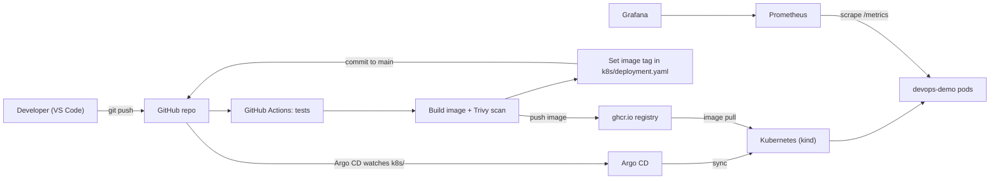

# DevOps Demo

A small end-to-end DevOps project for learning and demos: a tiny Flask app that goes from a `git push` to a running, monitored deployment on Kubernetes, with every step automated.

- **CI** with GitHub Actions: tests, image build, vulnerability scan
- **Registry**: GitHub Container Registry (ghcr.io)
- **GitOps** CD with Argo CD on a local kind cluster
- **Observability** with Prometheus and Grafana (dashboard stored in Git)
- **Dependency updates** with Dependabot

## How it fits together



**The release loop:** a push to `main` runs the tests, builds the image, scans it with Trivy, and publishes it tagged with the commit SHA. A final job writes that SHA into `k8s/deployment.yaml` and commits it back. Argo CD sees the new commit and rolls out the new version. Nobody runs `kubectl` to deploy.

## Repository layout

| Path | What it is |
|------|------------|
| `app.py`, `test_app.py`, `requirements.txt` | The Flask app (`/`, `/health`, `/metrics`) and its tests |
| `Dockerfile` | Python 3.14 slim image, OS patches applied, pip removed, non-root user |
| `.github/workflows/ci.yml` | Jobs: `test`, `build-scan-push`, `update-manifest` |
| `.github/dependabot.yml` | Weekly updates for Actions, pip packages and the base image |
| `k8s/` | Deployment, Service, ServiceMonitor and Grafana dashboard (everything Argo CD syncs) |
| `argocd/application.yaml` | Tells Argo CD to watch `k8s/` on `main` |

## Prerequisites

Ubuntu with Docker Engine (real Docker, not the `podman-docker` shim), plus `kubectl`, `kind` and `helm`. Your user must be in the `docker` group.

## Run the app locally

```bash
python3 -m venv .venv && source .venv/bin/activate
pip install -r requirements.txt
pytest
python app.py              # http://localhost:8080
```

## Rebuild the whole environment

Order matters: the monitoring stack installs the `ServiceMonitor` type that Argo CD later applies.

```bash
# 1. Cluster
KIND_EXPERIMENTAL_PROVIDER=docker kind create cluster --name devops-demo

# 2. Monitoring stack (Prometheus + Grafana)
helm repo add prometheus-community https://prometheus-community.github.io/helm-charts
helm repo update
helm install kube-prometheus-stack prometheus-community/kube-prometheus-stack \
  -n monitoring --create-namespace \
  --set alertmanager.enabled=false \
  --set kubeControllerManager.enabled=false \
  --set kubeEtcd.enabled=false \
  --set kubeScheduler.enabled=false \
  --set kubeProxy.enabled=false

# 3. Pull secret, only if the ghcr.io package is private
#    Use a classic token with the read:packages scope only. Never commit it.
read -s -p "GitHub token: " GHCR_TOKEN; echo
kubectl create secret docker-registry ghcr-pull \
  --docker-server=ghcr.io --docker-username=mrialdev01 --docker-password="$GHCR_TOKEN"
unset GHCR_TOKEN

# 4. Argo CD
kubectl create namespace argocd
kubectl apply -n argocd --server-side --force-conflicts \
  -f https://raw.githubusercontent.com/argoproj/argo-cd/stable/manifests/install.yaml

# 5. Tell Argo CD to deploy this repo
kubectl apply -f argocd/application.yaml
```

If the repository is private, give Argo CD read access (Argo CD UI: Settings, Repositories) before step 5.

## Access the UIs

Each command runs in its own terminal and keeps running.

| What | Command | URL |
|------|---------|-----|
| App | `kubectl port-forward svc/devops-demo 8081:8080` | http://localhost:8081 |
| Argo CD | `kubectl -n argocd port-forward svc/argocd-server 8443:443` | https://localhost:8443 |
| Grafana | `kubectl -n monitoring port-forward svc/kube-prometheus-stack-grafana 3000:80` | http://localhost:3000 |
| Prometheus | `kubectl -n monitoring port-forward svc/kube-prometheus-stack-prometheus 9090:9090` | http://localhost:9090 |

Passwords (user `admin` in both):

```bash
kubectl -n argocd get secret argocd-initial-admin-secret -o jsonpath="{.data.password}" | base64 -d; echo
kubectl -n monitoring get secret kube-prometheus-stack-grafana -o jsonpath="{.data.admin-password}" | base64 -d; echo
```

## Demo script

1. **Show the pipeline.** Change the greeting and version in `app.py`, update the expected version in `test_app.py`, then commit and push.
2. **Watch GitHub Actions.** `test`, then `build-scan-push` (Trivy gate), then `update-manifest`. Pull afterwards to see the `Deploy <sha>` commit.
3. **Watch Argo CD.** It detects the new tag in Git and rolls out the pods (click Refresh to skip the polling interval of about 3 minutes).
4. **Confirm.** `curl localhost:8081` returns the new greeting and version.
5. **Show GitOps self-heal.** Run `kubectl scale deployment/devops-demo --replicas=1` and watch Argo CD restore the count from Git.
6. **Show observability.** Open the **DevOps Demo** dashboard in Grafana and generate traffic:
   ```bash
   kubectl run curl-test --rm -it --restart=Never --image=curlimages/curl -- \
     sh -c 'for i in $(seq 1 300); do curl -s -o /dev/null http://devops-demo:8080/; sleep 0.2; done'
   ```

## Lessons learned and gotchas

- **Pin third-party actions.** An old Trivy action tag disappeared after a supply-chain incident in March 2026. Tags can be moved; pinning an action to a full commit SHA is the hardened practice.
- **Scan findings can come from the base image.** Trivy flagged OS packages (fixed by `apt-get upgrade`) and the bundled libraries inside pip (fixed by removing pip from the final image).
- **Image tags and GitOps.** With `:latest`, Git never changes, so Argo CD sees nothing to deploy. Tagging with the commit SHA makes every release a change in Git.
- **`kubectl port-forward svc/...` picks one pod.** It does not load balance. Real balancing is done by kube-proxy for traffic inside the cluster.
- **kind exposes its API on a random host port** that can change after a restart. If `kubectl` says "connection refused", run `KIND_EXPERIMENTAL_PROVIDER=docker kind export kubeconfig --name devops-demo`.
- **Control-plane targets in Prometheus** (etcd, scheduler, controller-manager, kube-proxy) show as down on kind because they listen only on localhost. They are disabled in the Helm install above.
- **Label clash in the dashboard.** The app's `endpoint` metric label collides with a label Prometheus adds, so it is stored as `exported_endpoint`.
- **Podman vs Docker.** The `podman-docker` package fakes the `docker` command, and kind then tries its experimental Podman provider. Install real Docker Engine instead.

## Clean up

```bash
KIND_EXPERIMENTAL_PROVIDER=docker kind delete cluster --name devops-demo
```
